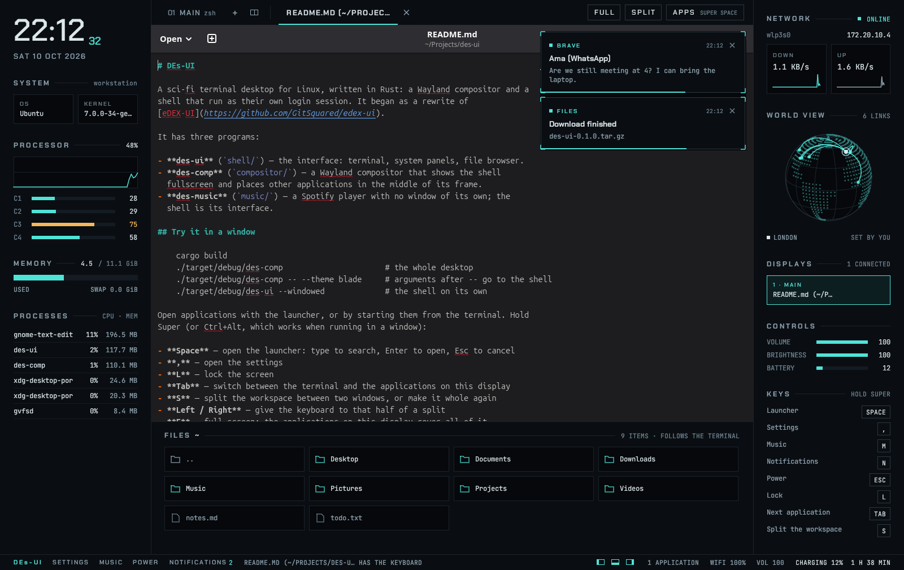
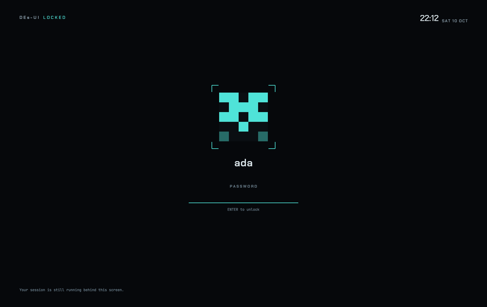

<div align="center">

<a href="https://coxy-trophy.github.io/des-website/"></a>

# DEs-UI

**A sci-fi terminal desktop for Linux, written in Rust.**

A Wayland compositor and a shell that run as their own login session:
the terminal in the middle, the machine drawn around it, applications inside the frame.

**[Website](https://coxy-trophy.github.io/des-website/)** · [Try it](#try-it-in-a-window) · [Install](#install-as-a-login-session) · [Keys](#keys) · [What is in it](#what-is-in-it) · [Not done yet](#not-done-yet)

</div>

> [!NOTE]
> DEs-UI is in development and is being built in the open. It is used daily on one
> machine; expect rough edges on yours. [What is missing](#not-done-yet) is listed
> plainly, and [docs/UNTESTED.md](docs/UNTESTED.md) lists what is built but not yet
> tried on real hardware.

The website has a version of the desktop you can use in the browser:
**[coxy-trophy.github.io/des-website](https://coxy-trophy.github.io/des-website/)**

## What it looks like

| | |
|:---:|:---:|
| <br>**An application** in the workspace, with notifications | <br>**The launcher** — <kbd>Super</kbd>+<kbd>Space</kbd> |
| <br>**The music player** — <kbd>Super</kbd>+<kbd>M</kbd> | <br>**The settings** — <kbd>Super</kbd>+<kbd>,</kbd> |
| <br>**The lock screen** — <kbd>Super</kbd>+<kbd>L</kbd> | <br>**The desktop** as it starts |

## What it is

One login session, made of three programs:

| Program | Where | What it does |
|---|---|---|
| **`des-ui`** | `shell/` | The interface: terminal, system panels, file browser, launcher, settings, lock and login screens. |
| **`des-comp`** | `compositor/` | A Wayland compositor that shows the shell fullscreen and places other applications in the middle of its frame. |
| **`des-music`** | `music/` | A Spotify player with no window of its own; the shell is its interface. |

```
┌─ des-comp ── drives the displays and input ───────────────┐
│ ┌─ des-ui ── drawn fullscreen ──────────────────────────┐ │
│ │ clock    │  terminal                      │ network   │ │
│ │ system   │  and your applications,        │ globe     │ │      ┌─ des-music ─┐
│ │ cpu, mem │  Wayland or X11                │ keys      │ │◄────►│ no window   │
│ │ procs    ├────────────────────────────────┤           │ │socket│ PipeWire    │
│ │          │  files (follow the terminal)   │           │ │      └─────────────┘
│ └───────────────────────────────────────────────────────┘ │
└───────────────────────────────────────────────────────────┘
```

## Inspired by eDEX-UI

DEs-UI began as a rewrite of **[eDEX-UI](https://github.com/GitSquared/edex-ui)** by
GitSquared, the sci-fi terminal that made this look famous. eDEX-UI was archived in
2021. DEs-UI takes the idea further in one direction: instead of an application that
covers your desktop, it *is* the desktop.

| | eDEX-UI | DEs-UI |
|---|---|---|
| What it is | A fullscreen terminal application | A desktop: its own login session |
| Runs | Inside your existing desktop | In place of it, with its own Wayland compositor |
| Built with | Electron (JavaScript) | Rust |
| Platforms | Windows, macOS, Linux | Linux |
| Other applications | Stay outside, behind it | Open inside the frame, with workspaces and splits |
| Settings, lock and login screens | No; those belong to the desktop under it | Yes |
| Themes | Its own JSON format | The same format; eDEX-UI theme files work |
| On-screen keyboard, sound effects | Yes | [Not yet](#not-done-yet) |
| Licence | GPL-3.0 | MIT |
| Status | Archived, no longer maintained | In development |

No code is shared between the two. Only the theme format is, so that themes made for
eDEX-UI can be used here.

## Try it in a window

Nothing is installed and nothing on your machine changes:

```sh
sudo apt install libudev-dev libinput-dev libgbm-dev libseat-dev cage
git clone https://github.com/coxy-trophy/des-ui
cd des-ui
cargo build

./target/debug/des-comp                      # the whole desktop
./target/debug/des-comp -- --theme blade     # arguments after -- go to the shell
./target/debug/des-ui --windowed             # the shell on its own
```

Open applications with the launcher, or by starting them from the terminal.
`des-ui --list-apps` prints what the launcher offers.

## Install as a login session

    sudo apt install libudev-dev libinput-dev libgbm-dev libseat-dev cage
    ./install.sh

Then log out and choose **DEs-UI** from the session menu on the login screen.
Exiting the last shell, or Ctrl+Shift+Q, ends the session. `./uninstall.sh`
removes it again.

In the session, `des-comp` drives the displays and input devices itself (one GPU,
every monitor connected to it, including ones plugged in later). If that fails in the first seconds it falls back to running inside
`cage`, and the reason is in `~/.local/state/des-ui/session.log`. What applications started
from the launcher print goes to `apps.log` next to it.

Ways out if something goes wrong: **Ctrl+Alt+Backspace** ends the session, and
**Ctrl+Alt+F1…F12** switch virtual terminals.

### As a package

On Ubuntu 26.04, from the project's apt repository:

    curl -fsSL https://coxy-trophy.github.io/des-ui-apt/des-ui.gpg | sudo tee /usr/share/keyrings/des-ui.gpg >/dev/null
    echo "deb [signed-by=/usr/share/keyrings/des-ui.gpg] https://coxy-trophy.github.io/des-ui-apt ./" | sudo tee /etc/apt/sources.list.d/des-ui.list
    sudo apt update
    sudo apt install des-ui

That brings `des-ui`, the desktop, and with it `des-ui-music`, the Spotify player,
which is a package of its own so that it can be left out or removed. Updates then
arrive through `sudo apt upgrade`. Two more packages are there for the asking:

    sudo apt install des-ui-greeter && sudo des-ui-login enable
    sudo apt install des-ui-plymouth

`des-ui-greeter` is the login screen. Installing it changes nothing until
`des-ui-login enable` makes it this machine's login screen from the next boot;
`sudo des-ui-login disable`, or removing the package, puts back the one that was
there. `des-ui-plymouth` is the boot splash, in the colours of the default theme;
it becomes the one in use and rebuilds the boot image, which takes a minute.

To make the packages yourself, `packaging/build-deb.sh` builds all four into
`target/deb/`; a package suits the release of Ubuntu or Debian it was built on.
`packaging/make-repo.sh <folder> [<gpg key id>]` turns them into an apt repository,
and `packaging/publish.sh` does that into the `des-ui-apt` repository that GitHub
Pages serves, signing with the "DEs-UI packages" key of whoever runs it.

## Keys

Hold <kbd>Super</kbd>, or <kbd>Ctrl</kbd>+<kbd>Alt</kbd>, which works when running in a
window.

| Key | What it does |
|---|---|
| <kbd>Space</kbd> | Open the launcher: type to search, Enter to open, Esc to cancel |
| <kbd>,</kbd> | Open the settings |
| <kbd>L</kbd> | Lock the screen |
| <kbd>Tab</kbd> | Switch between the terminal and the applications on this display |
| <kbd>1</kbd> to <kbd>4</kbd> | Bring that workspace into view; with <kbd>Shift</kbd>, send the application in use there |
| <kbd>S</kbd> | Split the workspace between two windows, or make it whole again |
| <kbd>Shift</kbd>+<kbd>S</kbd> | Next layout: one window, two side by side, three columns, a master with up to four stacked beside it |
| <kbd>←</kbd> <kbd>→</kbd> | Give the keyboard to the window on that side |
| <kbd>Alt</kbd>+<kbd>←</kbd> <kbd>→</kbd> | Move the divider beside the window in use |
| <kbd>Enter</kbd> | Make the window in use the master, the first column |
| <kbd>F</kbd> | Full screen: the applications on this display cover all of it |
| <kbd>[</kbd> <kbd>]</kbd> <kbd>\</kbd> | Collapse or open the left, right and bottom panels |
| <kbd>Q</kbd> | Close the current application |
| <kbd>O</kbd> | Move the current application to the next display |
| <kbd>P</kbd> | Keep the current application in a corner above everything, or put it back |
| <kbd>W</kbd>, or <kbd>Super</kbd> alone | Open the overview of every workspace, or close it |
| <kbd>A</kbd> | Open the quick settings, or close them |
| <kbd>M</kbd> | Open the music player |
| <kbd>N</kbd> | Open the notifications |
| <kbd>Esc</kbd> | Open the power menu |
| <kbd>Shift</kbd>+<kbd>R</kbd> | Restart the shell on a new build; applications stay open |

Without Super: <kbd>Print</kbd> takes a screenshot or starts a recording, and
<kbd>Ctrl</kbd>+<kbd>Alt</kbd>+<kbd>Backspace</kbd> ends the session.

**The overview** shows the four workspaces of the display under the pointer side by
side (two by two on a narrow or turned display), each with live pictures of its
windows. Click a picture to go to it, click a workspace's empty ground to go there,
or drag a picture onto another workspace to send it there. Type to narrow the
pictures down by title or application; the arrows move the selection, Enter opens
it, Escape closes. `des-ui-ctl overview` opens it from a script.

**Alt+Tab** goes through the windows on the display in use, last used first, in a
strip over the desktop; Alt+Shift+Tab goes back, and letting go of Alt brings the
chosen one forward. **Alt+`** does the same among the windows of the application in
use. On a touchpad, three or four fingers swiped left or right change workspace, up
open the overview and down close it; other gestures go to the application.

The bar above the workspace lists the terminal tabs and every open application;
click one to switch to it. The application in use shows an arrow, to send it to
the next display, and a cross, to close it. `SPLIT`, `FULL` and `APPS` do what the
keys do, and the three small switches in the status strip collapse the panels.

A split keeps the window in view on the left and puts the application used before
it on the right. With one application open, that one goes right and the terminal
stays on the left.

The workspace can be shared four ways, chosen with the four small icons in the bar
above it or with Super+Shift+S: one application, two side by side, three columns of the
three used most recently, or a master on the left with up to four stacked on the right.
Drag the gap between two windows to move the divider, or use Super+Alt+Left and Right;
Super+Enter makes the window in use the master. Each workspace and display keeps its
own layout and dividers, and a saved session keeps them too. Where three columns would
be narrower than 320 pixels, fewer are shown.

There are four workspaces: sets of applications, one of which is in view at a time,
each with its own split and full screen. The numbered squares at the top of the
frame show which is in view and which hold something; a click goes to one, and
Shift+click sends the application in use there. The terminal and the frame are the
same in all of them. An application opens on the workspace in view.

With several displays, modes and arrangement follow what you chose in the settings,
or else the layout saved in GNOME's display settings (`~/.config/monitors.xml`)
when it covers the connected monitors.
Otherwise the frame is on a laptop's own panel and the others extend to its right.
Each further display shows its applications at full size, split or not.
Applications open on the display the pointer is on.

Rules in `~/.config/des-ui/rules` send applications where you want them when they
open, matched by app ID or X11 class (`*` and `?` work; the first match wins):

```
firefox        workspace=2
org.gnome.*    display=2 side
mpv            side
```

Side panels can minimize to a narrow rail; click the rail to reopen them. In
**Settings → Frame → Minimized side panels**, choose **Collapse** (the default)
or **Hide** to reclaim their entire width. The file browser still hides completely.
Action icons show their names and shortcuts on hover; status icons keep their readings.

Graphical applications appear in the bottom dock instead of the terminal tab bar.
Move the pointer to the bottom edge to reveal it; it slides away after you leave.
The dock grows to fit its icons, wrapping to another row at the screen edge without a scrollbar.
Click an app to focus it (repeated clicks cycle through its windows). Right-click to
pin/unpin, change pin order, open another window, close a window or send it to another
display. The launcher also offers **Pin to dock** on right-click. Pins are saved.

**Super+D** (or **Ctrl+Alt+D**) opens dock keyboard navigation: use **Left/Right**,
**Enter**, and **Escape**. In the terminal, **Ctrl+Shift+D** also opens it. Terminal
and launcher shortcuts remain available in the dock. **Settings → Frame → Animate
dock** turns the sliding motion off. Each display has its own dock, showing windows on that display and the same saved pins. Super+D opens keyboard navigation on the display under the pointer.
Launcher and dock use installed app icons; missing icons use a generic app symbol.

## Quick settings

**Quick settings** — **Super+A**, the sliders icon at the right of the status strip,
or a click on its readings: Wi-Fi, Bluetooth, volume and the output device,
brightness, the night light, Do not disturb and the on-screen keyboard, with the
battery and buttons to lock, open the settings or the power menu. Escape or a click
elsewhere closes it. When the volume or brightness changes from the keyboard's keys
or another program, a small meter shows it for a moment at the top right. A window
that asks for attention gets a pulsing dot on its dock icon and comes first among
the palette's windows.

## Calendar and notifications

**Calendar.** Click the clock for a month calendar with today picked out; the day
you choose lists its events. Put `.ics` files in `~/.config/des-ui/calendars/`, or
list calendar addresses (`https://` or `webcal://`, one per line) in
`~/.config/des-ui/calendars.list`; those are fetched at most every half hour. An
event is announced fifteen minutes before it starts. Times in a named zone are
taken as local time.

**Notifications** are grouped by application in the list; click a heading to fold
it. Applications that offer an answer get a REPLY field. **Settings → Sound &
screen → Quiet hours** keeps all but urgent notifications in the list between the
hours you choose.

## Command palette, sessions and health

**Super+Space** opens the command palette. Search installed apps, open windows,
settings sections, desktop actions and local filenames. App results focus an
existing window where possible; right-click still pins an app. Use Up/Down and
Enter, Escape to close, or CLEAR to start again. **FOLDERS** lets you choose up to
eight absolute folders separated by semicolons. By default it searches Documents,
Downloads and Desktop. Filename lookup is bounded, skips hidden/build folders and
symlinks, and never reads file contents. Refine the query when results are limited.

The palette also knows more than files. `ssh` hosts from `~/.ssh/config` open in a
new terminal tab; `2+2`, `10 km in mi`, `72 f in c` and `255 in hex` show an answer
as you type, and Enter copies it; `kill <name>` and `ps <name>` list your own
processes, and Enter ends one; `start`, `stop` and `restart` act on your systemd
units (system units only where polkit allows it). Your own entries go in
`~/.config/des-ui/commands/*.command`, as `key = value` lines: `name`, `exec`
(split like a desktop entry, never through a shell), `terminal = yes|no` and
`keywords`.

Type `clip` (or `clipboard`) for what you copied lately, newest first; `clip <words>`
narrows it. Enter copies an entry back; right-click pins it, removes it, or clears the
history. Up to 50 entries of text are kept, each up to 64 KB, in memory only: nothing
is written to disk and all of it is gone at logout. What a password manager copies is
never kept. It needs `wl-clipboard` (`wl-paste`).

**Settings → Session → SAVE SESSION** records installed application identities,
workspace/display placement and terminal folders/layout. **RESTORE SESSION** reuses
existing windows and terminals, opens recognized installed apps, and waits up to 30
seconds for their windows. These actions are also searchable in the palette. The
snapshot is private at `~/.local/state/des-ui-sessions/session.json` (or under
`XDG_STATE_HOME`). Restore is explicit; commands, running terminal processes and
unsaved document contents are not recovered. Saved dock pins remain in the usual
configuration file.

**Settings → Health** (or search “health”) checks compositor/music service status, native
helpers and log locations without changing system settings. Refresh reruns the
checks; recent log excerpts are bounded and common secret-bearing lines hidden.
OPEN LOG opens the full local log with your configured viewer.

**`des-ui-ctl`** drives the desktop from a script or a key binding: `lock`,
`workspace 2`, `toast "build done"`, `dock`, `launcher`, `settings [section]`,
`music toggle|next|prev`, `panel left|right|bottom`, `screenshot [screen|window|region]`,
and `state`, which prints what is open as JSON. It speaks to the shell over a private
socket of its own (`$XDG_RUNTIME_DIR/des-ui-control.sock`, yours alone); the
compositor still accepts commands only from its shell. While the screen is locked
only `lock`, `ping` and `state` are answered.

**Widgets.** A file in `~/.config/des-ui/widgets/` ending in `.widget` puts a
program's reading in a side panel: `name`, `exec` (split like a desktop entry, never
through a shell), `every = 5s`, `panel = left|right`, `kind = text|meter|series|list`.
The program's last line is shown as text, or read as JSON (`text`, `value`, `label`,
`series`, `state`, `lines`, `tooltip`). Programs run one at a time, for at most three
seconds; one that fails says "no answer". Examples are in `shell/assets/widgets/`.

## Accessibility

The shell's controls carry names a screen reader can read (AccessKit, which Orca reaches
over AT-SPI): buttons, switches, sliders, the launcher's results and the terminal tabs.
**Settings → Keyboard → On-screen keyboard**, or **Ctrl+Shift+K**, puts keys along the
foot of the desktop for a touchscreen. Shift, Ctrl and Alt hold for one key; `123`
switches to symbols. They type into the terminal and the desktop's own fields, not
into other applications.

## Starting with the session

**Autostart** — the programs that start with every session: those in
`~/.config/autostart` and the system's `/etc/xdg/autostart`, following the usual
rules (`Hidden`, `OnlyShowIn`/`NotShowIn` with `des-ui`, `TryExec`, GNOME's
enabled switch and delay). Each has a switch; turning a system entry off writes
your own copy with `Hidden=true`, and turning it back on removes that copy again.
ADD takes a command line, run as written without a shell, from the next session.
Other desktops' authentication agents, notification daemons and panels are left
out, since this desktop is each of those itself. Restarting the shell does not
start them again.

When an application needs an administrator (`pkexec`, a software centre, a disk
tool), the desktop asks for the password itself, in its own dialog over everything
but the lock screen. Three wrong tries end the request. Applications in a system tray
show in the status strip. Apps look sharp at fractional scales, middle-click pastes
what was last selected, and a window that wants your attention without having been
asked for is marked rather than pushed in front of you.

## Bars, wallpapers and launchers of your own

Tools made for wlroots desktops work here: `swaybg` for a wallpaper inside the
workspace, `waybar` or another bar, `wofi` or `fuzzel` as a launcher, `mako` for
notifications. A bar keeps applications clear of it on its display, but the frame
stays where it is. Nothing of them shows while the screen is locked. Start them with
an autostart entry.

## Typing other languages, games and virtual machines

Input methods reach applications through the Wayland text-input protocol: start
`fcitx5 -d` (an autostart entry does it at login) or `ibus-daemon -drx --panel disable`,
and the candidate list appears under the text cursor. Set `XMODIFIERS=@im=fcitx` only
for X11 applications, and leave `GTK_IM_MODULE` unset so GTK 4 uses text-input. Games
can capture the mouse; any desktop shortcut, locking or the screenshot chooser lets it
go. A virtual machine or remote desktop may take the desktop's shortcuts while it has
the keyboard, but Super+L, Ctrl+Alt+Backspace, console switching, the power key and
the volume, brightness and media keys always stay with the desktop.

## The terminal

**Ctrl+Shift+F**, the magnifying-glass button in the terminal toolbar, or “Find in terminal” in the palette
opens pane-local scrollback search. Enter and Shift+Enter move between literal
case-insensitive matches; Copy copies the match, CLEAR resets, and Escape returns
to the terminal. IME input stays in the field. A `+ · refine search` counter means
the match-storage limit was reached.

The wheel scrolls history in the pane under the pointer and scrolls inside terminal
applications. Hold Shift to use local history. Typing returns to the live prompt.

The terminal knows where each command begins and ends. bash, zsh and fish get a
small script sourced after your own files (it steps aside if another prompt
integration is already there; `DES_UI_SHELL_INTEGRATION=0` turns it off). A bar in
the gutter marks each prompt and a square its exit status, amber when it failed;
hover it for the number. **Ctrl+Shift+Up** and **Down** walk between prompts, a
click on a prompt's mark selects that command's output for Ctrl+Shift+C, and
"Copy last command output" in the palette copies it outright.

When the terminal in use is running `ssh`, the side panels follow it: the processor,
memory, processes, network, disks and the globe's connections are that machine's,
under a REMOTE heading with its name. The clock, battery, volume and brightness stay
yours (marked LOCAL). It asks the host every two seconds with one short `ssh` call of
its own, reusing a private control connection, and never with a password: a host you
reach only by typing a password shows NEEDS A KEY and the panels stay on this machine.
Tunnels (`ssh -N`, `ssh -W`) are not followed. Temperatures, fans and the GPU are not
read over ssh, so those sections fold away.

**Ctrl+Shift+`** drops a scratchpad terminal from the top of the workspace, over
whatever is in view, full screen applications included; the same keys put it away
again, and its shell keeps running meanwhile. Escape goes to the shell inside, not to
the scratchpad. "Scratchpad terminal" in the palette and `des-ui-ctl scratchpad` do
the same. Locking puts it away.

**Files.** A click on a file in the bottom panel picks it; **Space** shows it over the
workspace (pictures, text and source, a PDF's first page with poppler-utils, what a zip
or tar archive holds, how big a folder is, or at least what a file is), **← →** go
through the folder, **Space** or **Escape** closes. **Enter** or a double click types
its path into the terminal, as a click on a folder `cd`s into it. Drag a file out of
the panel and drop it on an application to open or attach it. Nothing is ever run:
the preview reads at most 50 MB, and the only helpers it uses are `file`,
`pdftoppm`, `unzip` and `tar`, each with the file as an argument.

Ctrl+Shift+T opens a tab and Ctrl+Tab moves between them. The terminal can also be
split in two, each half showing a tab of its own:

- **Ctrl+Shift+E** — split side by side; again to make it whole
- **Ctrl+Shift+O** — split one above the other
- **Ctrl+Shift+arrow** — give the keyboard to the pane in that direction, as does a
  click in it
- **Ctrl+Tab** — change the tab in the pane in use

The small divided-frame button beside `+` does the same as Ctrl+Shift+E. Both tabs
stay open when the split ends. This is separate from Super+S, which shares the
workspace with an application.

## What is in it

Each of these opens for the details.

<details>
<summary><b>Settings</b> — theme, terminal, displays, network, Bluetooth, sound, date and language, and more</summary>

**Super+,** or `SETTINGS` in the status strip opens them in place of the terminal;
Esc closes. Changes apply at once and are saved.

- **Appearance** — theme
- **Terminal** — font, text size, line height, cursor shape and blink, bold in
  bright colours, copy on select, scrollback
- **Frame** — which panels are open, now and at every start; and the companion,
  an animal that walks along the foot of the left column where there is room
  (a dog, fox, crab, duck, snake or turtle, or none)
- **Displays** — each monitor's resolution and refresh rate, how large things are
  drawn on it (100% to 200%), which way it is turned, their order left to right,
  which one is the main display, and whether each other one is a desktop of its
  own, mirrors the main display, or is off
- **Network** — Wi-Fi on or off, and joining, leaving and forgetting networks;
  wired ports; and VPNs, brought in from a WireGuard `.conf` or OpenVPN `.ovpn`
  file, then connected, disconnected or forgotten
- **Bluetooth** — on or off, and pairing, connecting and forgetting devices,
  including those that show a code to type or to confirm
- **Keyboard** — layout, and how held keys repeat
- **Mouse & touchpad** — natural scrolling, tap to click, pointer speed, left-handed
- **Globe** — rotation, online lookups, and your location
- **Sound & screen** — volume and brightness; which device plays and which
  microphone listens, each with its level and a mute; and the volume of each
  application that is making sound
- **Date & region** — the time zone, whether the network sets the time or you do,
  a 12 or 24 hour clock, and the language and formats programs use. All but the
  clock's hours are the system's, changed with `timedatectl` and `localectl`
  through `sudo`, and ask for your own password
- **Users** — the people who can sign in: adding one, changing a name or a
  password, making someone an administrator, and removing an account, with or
  without its files. Each change asks for your own password and is carried out by
  the system's own tools through `sudo`
- **Session** — your picture for the lock and login screens, locking, where the
  logs are, and logging out

A display change is tried for 15 seconds and kept only if you confirm it; otherwise
it goes back by itself, so a mode your monitor cannot show does not strand you.
Confirmed layouts are saved in `~/.config/des-ui/displays`, one per set of
monitors, and come before GNOME's saved layout.

The rest are kept in `~/.config/des-ui/config` as `key = value` lines, which can also
be edited by hand. The compositor reads the keyboard, mouse and touchpad
settings from the same file. Network scanning and saved connections use `nmcli`; Bluetooth uses
`bluetoothctl`. New Wi-Fi connections send credentials directly to NetworkManager
over the system D-Bus, without putting passwords in process arguments. Two can be set from a terminal:

    des-ui --set-location 48.8566,2.3522,Paris   # or: --set-location auto
    des-ui --geo off                             # no lookups at all; on to resume

X11 applications run through Xwayland, which `des-comp` starts and manages; the
clipboard is shared between them and Wayland applications.

Under **Settings → Appearance → Phosphor** the compositor can add a glow to bright
text and the accent, and the faint lines of a tube; **Night light** warms the colours
between the hours you choose, easing in and out over a minute. Both are drawn over
everything and cost nothing when off; screenshots and recordings stay clean. At start
the frame powers up: its lines sweep out of the splash and the panels and instruments
follow, unless Animate is off.

The look is called Signal (`shell/src/ui.rs`): fixed greys, two typefaces, and one
accent colour. A theme sets that accent and the terminal's colours, in the JSON
format eDEX-UI uses, so its theme files work here. `themes/` holds the built-in
one; your own go in `~/.config/des-ui/themes/`.

</details>

<details>
<summary><b>Locking</b> — by key, by itself, and before sleep</summary>

**Super+L**, or `LOCK NOW` under Session in the settings, hides everything behind
your password; what was running keeps running. While locked the compositor shows
nothing but the lock screen and sends it every key, so no shortcut reaches what is
behind it. The password is checked with the system's own helper, `unix_chkpwd`.

It also locks by itself:

- after ten minutes without a key or the pointer being touched (Session in the
  settings changes how long, or turns it off), though not while an application is
  playing something to watch;
- before the machine sleeps, so that closing the lid and opening it again shows the
  lock screen (this too can be turned off there);
- when the system asks, as `loginctl lock-session` does.

Unlocking requires your password on the lock screen. Command-line clients cannot
unlock the compositor; it accepts desktop commands only from its current shell.

</details>

<details>
<summary><b>Music</b> — a Spotify player in the workspace</summary>

**Super+M**, or `MUSIC` in the status strip, opens a Spotify player in the
workspace: search, your playlists, your saved albums and your liked songs, with the
track playing and its controls along the bottom. Long lists load the rest as you
scroll to their end. A track's artist and album can be clicked to go to them, search
finds albums and artists too, and `BACK` returns to the list you came from.

What plays on another of your devices shows here too, with `ON <DEVICE>` beside
it, and the controls then act on that device. `DEVICES` lists what is online; a
click moves the music there, or here. `REPEAT` goes from off to the whole list to
the one track, and `LIKE` puts the track among your liked songs (which asks once
more for Spotify's approval).

`LYRICS` shows the words of the track playing, from Spotify's own source. Where they
are timed to the music, the line being sung is picked out and kept in the middle,
and a click on any line goes to it. `UP NEXT` shows what is queued, and `+ QUEUE` on a
track under the pointer adds it. While something plays, the right column shows it
too, and the keyboard's play, next and previous keys work from anywhere.

It needs Spotify Premium, and two things done once, both from the music view:

1. **Sign in** (or `des-music login`), on Spotify's own page in your browser.
   This is what plays.
2. **Connect your library** (or `des-music library <client ID>`). Spotify turns
   away library requests made in a player's name, so reading playlists, liked songs
   and search needs an app of your own: at
   [developer.spotify.com/dashboard](https://developer.spotify.com/dashboard) create
   an app with the Redirect URI `http://127.0.0.1:8898/login` and the Web API ticked,
   and paste its Client ID into the music view.

`des-music logout` forgets both. Nothing else of Spotify needs to be installed or open.

The playing is done by `des-music`, built on
[librespot](https://github.com/librespot-org/librespot): it appears in Spotify's
device list as "DEs-UI", so a phone can control it as well, and it keeps playing
while the shell restarts. Sound goes out through PipeWire (`pw-cat`).

</details>

<details>
<summary><b>Power</b> — the power menu, the battery, and turning the screen off</summary>

**Super+Escape**, the power key, or `POWER` in the status strip opens the power
menu: lock, sleep, restart, shut down, log out. The last three take a second click.
While the screen is locked, the power key puts the machine to sleep.

The status strip shows the battery with the time left, or the time until it is
full. Running low, it says so at 15% and at 8%; at 4% the machine warns for a
minute and then goes to sleep, so that work is kept rather than lost to the
battery running out. Plugging in during that minute calls it off.

The screen can be turned off after a time left alone (Session in the settings;
off unless you choose a time). Any key or pointer movement turns it back on. Should
it ever stay dark, Ctrl+Alt+F3 and then Ctrl+Alt+F1 (or whichever console the
desktop is on) draws it afresh.

</details>

<details>
<summary><b>Screenshots and recordings</b> — full screen, an area, a window, or a recording</summary>

Press **Print** (PrtSc). The display stands still and asks what you want:

- **FULL SCREEN** (or F, or Enter): a picture of the display.
- **AREA** (or A): of a piece. Drag over the piece you want; dragging straight
  away, without choosing first, does the same.
- **WINDOW** (or W): of the window in use.
- **RECORD** (or R): start recording the display. `STOP` in the status strip, or
  Print and then **STOP RECORDING**, ends it. The strip shows how long it has
  been running.

Escape, Print again, or a click beside the choices calls it off. **Alt+Print**
and **Shift+Print** go straight to the window and to a piece.

Screenshots are saved in `~/Pictures/Screenshots` and, where `wl-copy` is
installed, also copied, ready to paste.

Applications that ask the desktop for a screenshot, such as a browser's
screen-capture extension or a colour picker in a design tool, go through the same
chooser: the `des-portal` program answers xdg-desktop-portal's Screenshot portal by
asking the shell. An interactive request lets you mark an area; a colour request asks
for a click. `des-ui-ctl screenshot-file region` and `des-ui-ctl pick-color` do the
same from a terminal and print the file or the colour as JSON. Recordings are saved in
`~/Videos/Recordings` as MP4, with the pointer and without sound; they need
`ffmpeg`. Both programs come with `sudo apt install ffmpeg wl-clipboard`.

Nothing is pictured while the screen is locked.

</details>

<details>
<summary><b>Notifications</b> — toasts, the list, and do not disturb</summary>

The shell is the session's notification service, so what applications announce (a
message in the browser, a finished download) shows as a toast at the top right of
the workspace, above whatever is open, and is kept in a list. The desktop adds its
own: battery low, network lost and found, a display connected or removed.

A toast stays a few seconds, longer under the pointer; an urgent one stays until
seen to. Clicking it does what its sender offered (usually: show the application),
and the cross puts it away for good.

Each shows its sender's picture or icon where there is one, and makes a sound when
it shows, unless it asks for silence or for a sound of its own. Several at once make
one sound. **Settings → Sound & Screen → Notifications** turns the sounds off; do not
disturb silences all but the urgent. Icons that exist only as drawings (SVG) are not
shown.

**Super+N**, or `NOTIFICATIONS` in the status strip, opens the list. `DO NOT
DISTURB` there keeps all but the urgent ones off the screen; they still reach the
list. Nothing is shown over the lock screen. What is playing is the exception: the lock screen
shows the track, its cover and how far along it is, with previous, play or pause, and
next to click, and the keyboard's media keys work there too.

</details>

<details>
<summary><b>The globe</b> — where this machine is connected to, and what that tells whom</summary>

The globe marks this machine and the places it has connections open to. Positions
come from looking addresses up at get.geojs.io, which tells that service the public
addresses this machine talks to; each is asked about once and kept in
`~/.cache/des-ui/places.tsv`. Your own position is guessed from your address
unless you set it.

</details>

<details>
<summary><b>The splash</b> — while the shell restarts, and optionally while the machine boots</summary>

While the shell restarts (Super+Shift+R), the screen shows the desktop's name over a
bar that fills, in your theme's accent; the name glitches now and then. The
compositor draws it, in place of the blank the shell would leave.

The same screen can stand in for the maker's logo while the machine boots and
shuts down:

```sh
./install-boot-splash.sh      # uses sudo; rebuilds the boot image, which takes a minute
```

It is a Plymouth theme, made in the colours of the theme you use at the time; run it
again after changing theme. `./uninstall-boot-splash.sh` puts back what was there.

</details>

<details>
<summary><b>Its own login screen</b> — optional, in place of GDM</summary>

Optional, and separate from the above, because it changes how the machine boots:

    ./install-login.sh

That installs greetd, a small login manager, and makes the DEs-UI login screen the
machine's own in place of GDM, from the next boot. `./uninstall-login.sh` puts GDM
back. To see the screen without any of that: `des-ui --greeter --windowed`.

The screen shows a picture, a name and a password line. The picture is a pattern
made from the name unless you give it one, in **Settings → Session**
or with `des-ui --set-avatar <file>`. F1 changes
the session, Tab the account when there are several, and the three marks at the
bottom right suspend, restart and shut down, each on a second click.

The screen is shown by `des-comp` itself; its log is
`/var/lib/des-ui/greeter/login.log`. If it cannot start, a text login takes its
place. If the machine ever comes
up with no usable login at all, press Ctrl+Alt+F3, sign in on the text console, and
run `sudo systemctl disable greetd && sudo systemctl enable gdm3 && sudo reboot`.

</details>

## Working inside it while changing it

- `./dev.sh` builds the working copy and runs it in a window inside the running
  session. Nothing installed is touched.
- `./install.sh` can be run from inside the session. **Super+Shift+R** then restarts
  the shell on the new build: managed terminal tabs reconnect, applications stay open. A new
  compositor takes effect at the next login.
- If the shell crashes it is started again and applications stay open. Only quitting
  it (Ctrl+Shift+Q, or closing the last tab) ends the session.
- `install.sh` keeps the build it replaces. If a new build cannot start at login, the
  session tries that one, then `cage`.
- Keeping terminals across shell restarts requires `tmux` 3.3 or newer and the
  Session setting enabled for new terminals. The compositor owns a private foreground server in its watchdog process group;
  it preserves running commands through a shell restart or crash, and cleans up
  when the desktop exits. Logout and reboot do not preserve live processes.
  Standalone shells and direct terminals close their processes when they exit.
  **Terminals created before this feature cannot be converted. Save their work
  before the first upgrade or restart.** Both the compositor and shell need the
  updated build; a shell-only update on an older compositor cannot enable live
  preservation. Settings → Session controls the default for new terminals.

## Layout

<details>
<summary><b>Where things are in the source</b> — file by file</summary>

- `shell/src/runtime.rs` — per-frame shell coordination and rendering
- `shell/src/radio/wifi.rs` — new Wi-Fi connections over NetworkManager D-Bus
- `music/src/service.rs` — playback state and service lifecycle
- `music/src/ipc.rs`, `socket.rs` — bounded music transport and private socket setup
- `shell/src/term.rs` — shell on a PTY, VT parsing, grid rendering, key encoding
- `shell/src/sysmon.rs` — CPU, memory, process and network sampling
- `shell/src/ui.rs` — the interface language: colours, typefaces, shared parts
- `shell/src/panels.rs` — side columns, file browser, status strip
- `shell/src/globe.rs`, `geo.rs` — the rotating globe and the places on it
- `shell/src/settings.rs`, `config.rs` — the settings screen and the file behind it
- `shell/src/radio.rs` — Wi-Fi, wired and VPN connections, Bluetooth
- `shell/src/sound.rs` — output and input devices, levels, per-application volume
- `shell/src/users.rs` — the accounts on the machine
- `shell/src/region.rs` — the date, the time zone and the language
- `shell/src/pet.rs` — the companion in the left column
- `shell/src/greeter.rs`, `lock.rs` — the login screen and the lock screen
- `shell/src/power.rs` — locking before sleep, and what holds off the idle lock
- `common/src/input.rs` — keyboard, mouse and touchpad settings
- `shell/src/apps.rs`, `launcher.rs` — installed applications and the launcher
- `shell/src/theme.rs` — eDEX-UI theme loader
- `shell/src/music.rs` — the music view and what is playing
- `compositor/src/capture.rs`, `shell/src/capture.rs` — screenshots and recordings
- `compositor/src/splash.rs` — the splash shown while the session starts
- `shell/src/notify.rs`, `compositor/src/toast.rs` — notifications, and how their
  toasts get above the applications
- `music/src/main.rs`, `web.rs`, `protocol.rs` — the Spotify player, the library
  lookups, and the lines it exchanges with the shell
- `compositor/src/policy.rs` — which window is shown on which display
- `compositor/src/udev.rs`, `winit.rs` — the hardware and windowed backends
- `compositor/src/displays.rs`, `monitors.rs` — display settings and saved layouts
- `compositor/src/xwayland.rs`, `focus.rs` — X11 applications
- `compositor/src/ipc.rs`, `shell/src/desktop.rs` — the socket the two talk over
- `common/` — frame geometry and that socket's protocol, shared by both
- `session/` — login session entry and launcher

</details>

## Not done yet

- Dialogs at their natural size; sharing the middle-click selection with X11 applications
- Placing displays above one another
- VPNs that ask for a password each time they connect
- In the music player: removing from or reordering the queue (Spotify offers outside
  apps no way to), an artist's most played tracks, the artists you follow, adding
  to and editing playlists, podcasts
- In notifications: icons that exist only as SVG drawings
- On the login screen: accounts that need more than a password
- From the original: on-screen keyboard, sound effects, mouse click and motion reporting to
  terminal apps

## Validation

`./scripts/verify.sh` checks installation-script syntax, runs every workspace test,
and builds all three programs. Run it on a Linux host that permits Unix sockets;
restricted sandboxes can fail the socket integration tests. Those failures must not
be treated as passing tests.

`python3 scripts/validation-snapshot.py > /tmp/des-ui-source.json` records the exact
working source, including uncommitted and untracked files, without changing Git.
Use [docs/validation/HARDWARE.md](docs/validation/HARDWARE.md) with
[docs/UNTESTED.md](docs/UNTESTED.md) to attach real-machine evidence before a release.

The music socket requires an absolute path in a directory owned by the current user
with mode 0700; the socket itself is mode 0600. Without `XDG_RUNTIME_DIR`, it uses
`$TMPDIR/des-music-<uid>/des-music.sock` (normally under `/tmp`). Set
`DES_MUSIC_SOCKET` to try another private socket. Clients must finish requests within
60 seconds; the shell sends an idle heartbeat every 20 seconds.

## Licence

MIT; see `LICENSE`. `compositor/` is derived from Smithay's `smallvil` example, also
MIT. The bundled typefaces, Chakra Petch and JetBrains Mono (`shell/assets/fonts/`),
are under the SIL Open Font License.

The companions (`shell/assets/pets/`) are from
[VS Code Pets](https://github.com/tonybaloney/vscode-pets) and keep their own terms:
see `CREDITS.md` there. The dog is under Creative Commons Attribution-NoDerivatives
4.0, so its pictures are used unchanged.

eDEX-UI's own theme files are GPL-3.0 and are not part of this repository. They
work as themes here: copy them into `~/.config/des-ui/themes/`.

### Processor temperature notifications

In **Settings → Sound & Screen → Notifications**, turn off **Processor temperature warnings** to stop “Processor running hot” notices. The choice is saved as `processor_temperature_warnings = off` in the configuration. Temperature readings and memory, disk and service warnings remain enabled. Existing notification history is retained.

### Startup recovery and input-method security

The login session now uses a Python 3 startup watchdog that waits for initialized shell readiness. See [session/STARTUP.md](session/STARTUP.md) for recovery behavior and compatibility. Privileged external Wayland input-method integration is disabled until a trusted launch mechanism is available; ordinary text-input and the shell keyboard remain supported.
